# Slides under a magnifying glass

**A vision-language model with crop and zoom.** Course project, *Modern Methods and Algorithms of Generative AI*.
Vladislav Voronin, Pavel Vasilevykh · AIFT'27

A small vision-language model (Qwen3-VL-4B-Instruct, 4-bit) answers questions about presentation slides that hinge on a small detail: a label, a value on a chart, a link between blocks. We give it a crop and zoom tool, let it choose the regions, and measure when that beats a bigger picture.

[Summary](#summary) · [How it works](#how-it-works) · [Data](#data) · [Results](#results) · [Error analysis](#error-analysis) · [Demo](#demo-examples) · [Reproduce the demo](#reproducing-the-demo) · [Repository](#repository-layout) · [Setup](#setup) · [Limitations](#limitations)

## Summary

1. On 1024 px SlideVQA slides a bigger single view is the cheapest gain. 768 visual tokens give exact match (EM) 0.79 and 1500 tokens give 0.82, while the zoom agent scores 0.66 to 0.71 at 1770 to 2664 tokens.
2. On 2560 px slides zoom lifts the agent from 0.62 (same overview, no zoom) to 0.85. A at 768 tokens (0.90) and B at 1500 tokens (0.93) are within noise of it. Fixed tiles score highest on dense small print (0.95).
3. Zoom fixes text that is too small to read (1 such error left against 12) and adds wrong-box errors (10 against 0). A third of the agent's errors are format mismatches, so exact match understates both modes.

The model reads boxes in the right coordinate space and a crop gives it real detail. Choosing the region is the weak step. When the first look is already large enough, zoom adds cost and loses accuracy.

## Research questions

| | Question | How we check |
|---|---|---|
| RQ1 | When does zoom help? | The zoom agent against the same slide at a larger budget and against fixed tiles |
| RQ2 | Where does the model look? | Whether its boxes sit on the evidence, and whether it zooms when it should |
| RQ3 | What errors remain? | Wrong answers sorted into no zoom, wrong region, misread text, format, reasoning |

## How it works

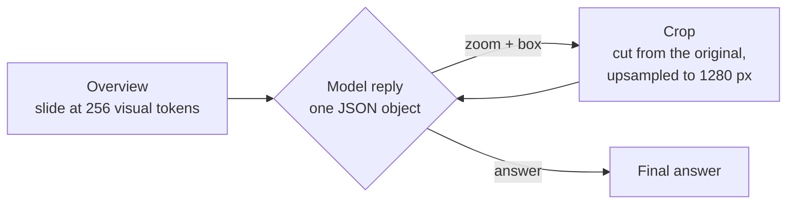

The protocol is JSON inside the prompt, not native tool calling, because small models break chat-template parsers.

```
{"action": "zoom", "box": [x1, y1, x2, y2]}      coordinates 0 to 1000 relative to the full slide
{"action": "answer", "answer": "..."}
```

Loop guards: at most 3 zooms per question, then the model must answer. A box with IoU above 0.7 against an earlier box ends the zooming. Two bad regions end it too. After a JSON parse error the model gets one retry, then the answer is empty and logged as a format error.

A visual token covers about 32×32 px. A 1024×768 slide costs exactly 768 tokens at native resolution.

### Viewing modes

| Mode | What the model sees | Role |
|---|---|---|
| A | Whole slide, 256 visual tokens, no zoom | Baseline |
| B | Whole slide, 1500 tokens, no zoom | Is a bigger view enough? |
| C | Overview plus 4 tiles (2×2, 10% overlap) cut from the original, in one query | Fixed-crop baseline |
| D | Overview, then up to 3 crops chosen by the model | Zoom agent |
| E | As D, but exactly one box is forced before the answer | Ablation of D |
| F | Same view as A, answer requested as JSON | Control for answer format |

Two extra runs use a 768-token overview: A at 768 tokens and D at 768 tokens.

## Data

| | |
|---|---|
| **400** | SlideVQA test questions, one evidence slide each: 284 text and 116 numeric answers. Single-hop, answers of at most five words, at most two questions per deck |
| **30 + 120** | dev and test split, ids fixed once in `splits.json`, balanced between text and numeric answers |
| **40** | own questions on 2560 px slides: 20 on course slides (5 per detail type: axis label, chart value, small text, block relation) and 20 on dense slides with small print |

The model sees only the evidence slide, never the whole deck. Questions were not chosen by model errors.

**Size check.** The median longest side of SlideVQA slides is 1024 px, and so are the 10th and 90th percentiles. The original has no more pixels than a 768-token view, so zoom can add little on this dataset. That is why we added the 2560 px questions, where zoom can recover real detail.

## Metrics and statistics

- EM = 1 if `norm(pred)` equals `norm(gold)` for any accepted gold answer. F1 is the best word-overlap F1 over the gold answers.
- `norm`: lowercase, thousands commas removed, punctuation to spaces, articles dropped. An empty or invalid answer scores 0 and stays in the denominator.
- 95% intervals: bootstrap over questions, 2000 resamples. Paired differences: bootstrap on per-question score differences. Exact McNemar test on EM, using only questions where two modes disagree.
- Threshold p < 0.006 for 8 comparisons. Two comparisons clear it: A to B and B to D.

## Results

### SlideVQA test, 120 questions

Greedy decoding, Qwen3-VL-4B-Instruct 4-bit via mlx-vlm on a 16 GB Apple Silicon Mac.

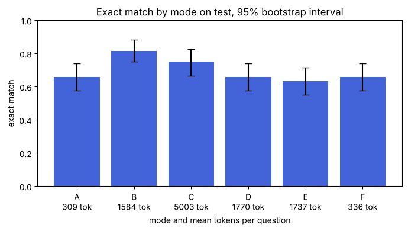

| Mode | EM (95% CI) | F1 | Zoomed on | Tokens / question | Seconds / question |
|---|---|---|---|---|---|
| A, 256 tokens | 0.66 (0.57 to 0.74) | 0.73 | 0% | 309 | 1.6 |
| A768, 768 tokens | 0.79 (0.72 to 0.86) | 0.87 | 0% | 799 | 4.6 |
| B, 1500 tokens | 0.82 (0.75 to 0.88) | 0.86 | 0% | 1584 | 10.9 |
| C, overview + 4 tiles | 0.75 (0.67 to 0.83) | 0.83 | 0% | 5003 | 36.6 |
| D, zoom agent | 0.66 (0.57 to 0.74) | 0.74 | 84% | 1770 | 12.8 |
| D768, agent with 768-token overview | 0.71 (0.63 to 0.78) | 0.80 | 87% | 2664 | 18.5 |
| E, one forced zoom | 0.63 (0.55 to 0.72) | 0.74 | 99% | 1737 | 11.7 |
| F, A with JSON answer | 0.66 (0.57 to 0.74) | 0.72 | 0% | 336 | 2.1 |

With 120 questions an accuracy near 0.7 has an interval of about ±9 points, so small gaps are not effects.

### Paired comparisons

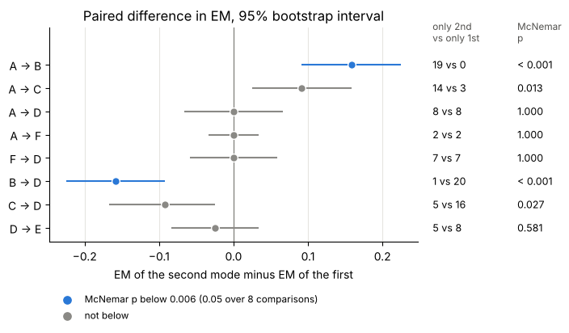

| Pair | Result |
|---|---|
| A to B | +16 points: 19 questions gained, 0 lost, p < 0.001 |
| A to D | no effect of zoom: 8 against 8. F to D is 7 against 7 at the same answer format |
| A to F | format does not matter: 2 against 2, so JSON answers cost no accuracy |
| B to D | −16 points: 1 gained, 20 lost, p < 0.001 |

### Answer type and zoom usage

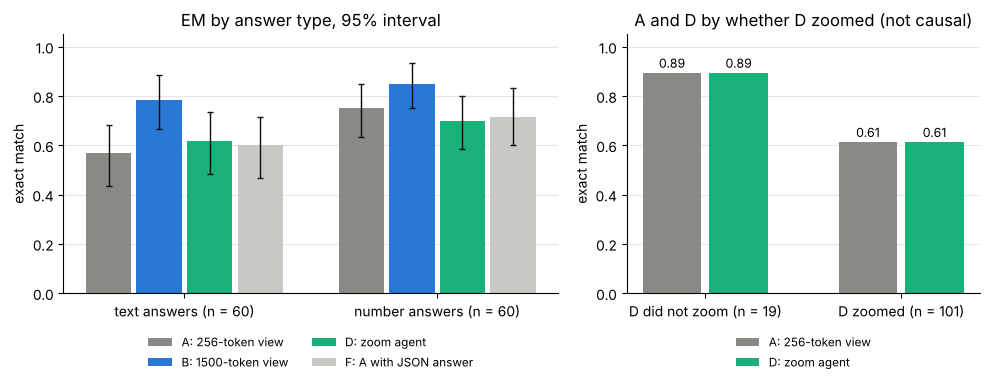

Text answers gain most from a bigger view (B 0.78, A 0.57); numbers gain less (0.85 against 0.75). D skips zoom on 19 of 120 questions, mostly easy ones: A and D both score 0.89 there and 0.61 on the 101 zoomed ones. The model chooses when to zoom, so the two groups differ and the comparison is not causal.

### Overview budget: 256 against 768 tokens

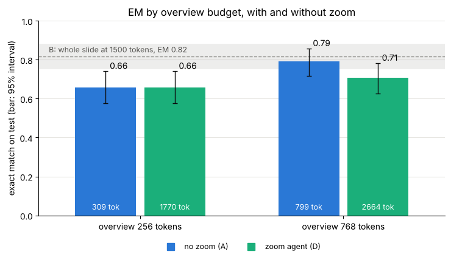

A goes from 0.66 to 0.79 with the 768-token view. D at 768 reaches 0.71, 8 points under A at 768 (12 questions against 2, p = 0.013). A 1024×768 slide costs exactly 768 tokens at native resolution, so zoom has nothing to recover and only adds cost.

### Accuracy against cost

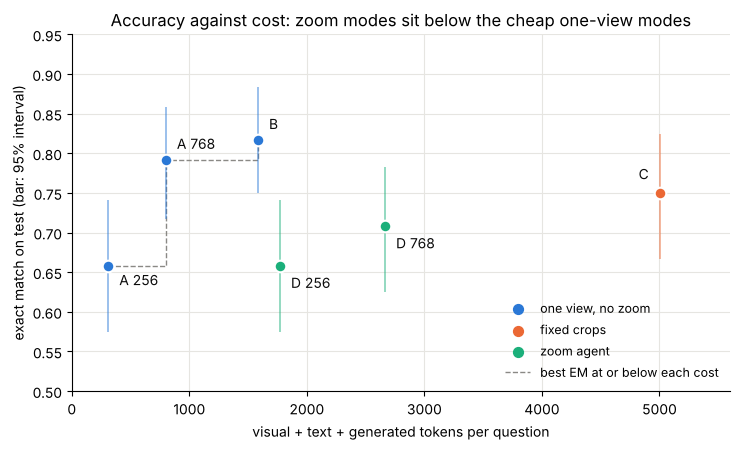

A at 256 tokens, A at 768 tokens and B sit on the frontier. Both agent runs and C (EM 0.75 at 5003 tokens) are below it. From 768 to 1500 tokens the gain is 2.5 points for about 780 more tokens, inside the noise (p = 0.375).

### Own and dense slides at 2560 px

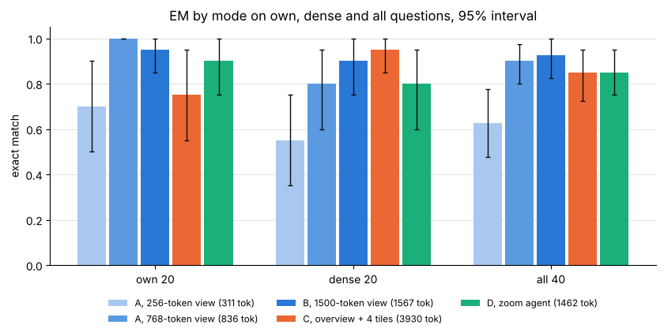

| Mode | Own, 20 | Dense, 20 | All 40 | Tokens (all 40) |
|---|---|---|---|---|
| A, 256 tokens | 0.70 | 0.55 | 0.62 | 311 |
| A768, 768 tokens | 1.00 | 0.80 | 0.90 | 836 |
| B, 1500 tokens | 0.95 | 0.90 | 0.93 | 1567 |
| C, overview + 4 tiles | 0.75 | 0.95 | 0.85 | 3930 |
| D, zoom agent | 0.90 | 0.80 | 0.85 | 1462 |

D beats A by 22.5 points on all 40 (13 questions against 4, p = 0.049). A at 768 tokens beats A at 256 by 27.5 points (13 against 2, p = 0.007), the clearest effect here. D against A768 and B is inside the noise. On the dense questions C scores 0.95, and small text rises from 0.60 (A) to 0.93 (B and C). With 20 to 40 questions an interval is about ±15 to 20 points, so only large gaps count.

**By detail type, 5 own questions per type**

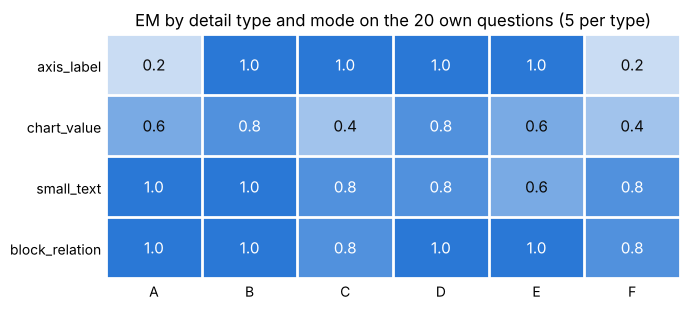

Axis labels: A and F score 0.2, B, C, D and E read them (1.0). Chart values are the weakest type for every mode (0.4 to 0.8). Blocks and small text are easy at this slide size (0.6 to 1.0). One question moves a cell by 0.2.

## Error analysis

Each of A and D makes 41 errors on the 120 test questions. We sampled 30 errors per mode with a fixed seed and sorted them by cause from a montage of the slide, the boxes and the crops.

| Category | Meaning | A | D |
|---|---|---|---|
| `no_zoom` | the needed text was too small and no zoom was requested | 12 | 1 |
| `wrong_region` | the box misses the evidence or cuts it | 0 | 10 |
| `format` | right in meaning, exact match is 0 | 8 | 10 |
| `misread` | right region, text read wrongly | 3 | 2 |
| `reasoning` | needs a calculation, a comparison or several slides | 5 | 6 |
| `bad_gold` | the gold label looks wrong | 2 | 1 |

Zoom removes most of the `no_zoom` errors and adds wrong boxes, so A and D both make 41 errors. Scaled to all 41 errors, D has about 14 wrong boxes and 14 format mismatches. A third of D's errors are format mismatches. The shares come from samples of 30, so each count is uncertain by several errors. The tables are in `errors/`.

## Demo examples

Each picture shows the slide with the numbered box that mode D chose (left) and the crop the model received (right). All nine demo questions with exact numbers are in [`examples/expected_results.md`](examples/expected_results.md).

**Zoom works.** `dense_12`: "What value is shown for DreamZero (Scratch) on task 2, Remove Hat from Mannequin?" A answers 28.6. D boxes the dark bar of task 2, reads 85.7 in the crop and is right.

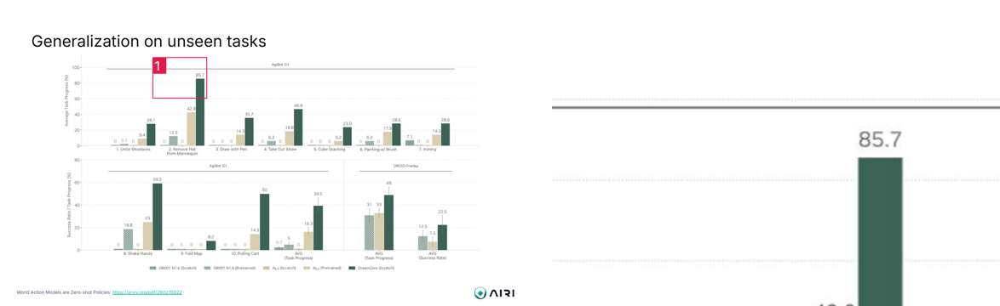

**Zoom reads a small diagram.** SlideVQA test question 32: "What is the abbreviation for Sales Qualified Leads?" A answers SAL. D boxes the tiny diagram block and reads SQL.

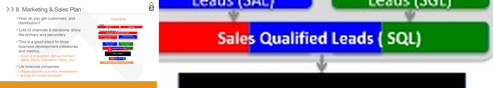

**Axis label.** `own_05`: "What is the label of the vertical axis of the plot?" A invents "Decoding cost per token (in $)". D boxes the rotated title and reads "FLOPs per generated token, one layer".

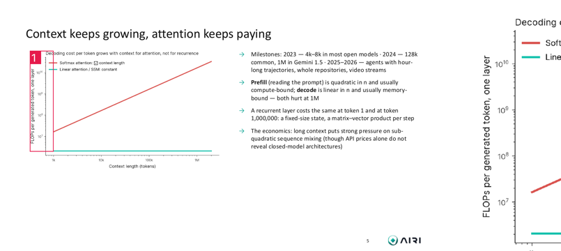

**Right answer, wrong region.** `dense_17`: "What FVD does DIAMOND-HQ get in the 3D Game Simulation: CS:GO block?" A answers 17.5. D answers 368.5, which is right, but its box covers the row label, not the number. A correct answer does not prove that the model looked in the right place, which is why the error analysis checks boxes and not only answers.

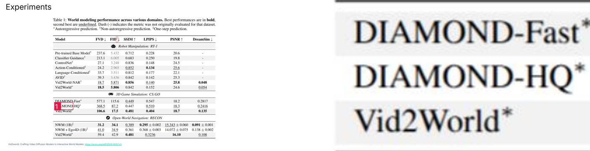

**Right region, wrong bar.** `dense_14`: "What value is shown for DreamZero (Scratch) on PnP Easy?" Gold 93.8. D boxes the right group and the crop shows 93.8, but it answers 2.1, the value of another bar.

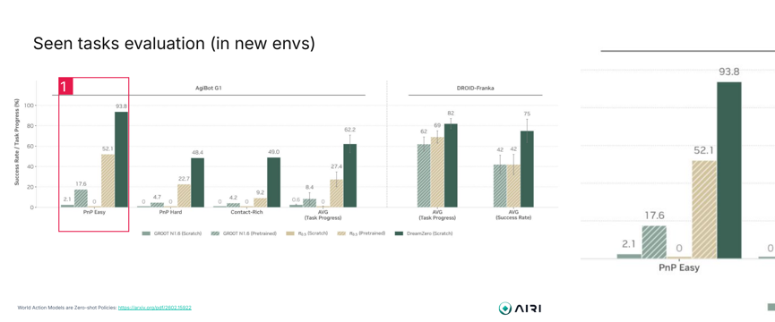

**The box cuts the evidence.** SlideVQA test question 877: "How many players were in the pre-1983 market?" Gold 5. A answers 5. D boxes the list, but the box ends in the middle of the last name, and D answers 4.

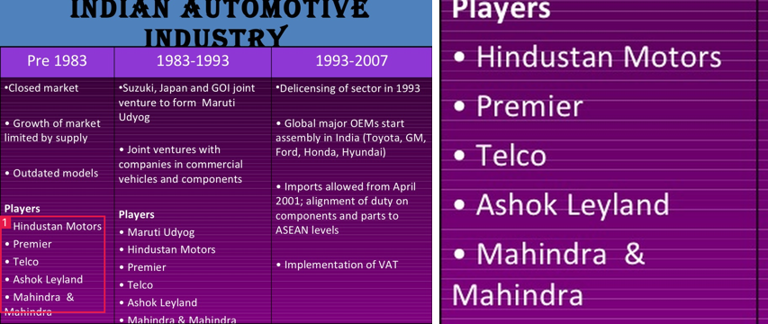

## Reproducing the demo

The folder `examples/` holds everything needed to repeat the demo: 6 slides (`examples/slides/`), 9 questions with gold answers (`examples/questions.csv`), the recorded answers of modes A, B, C and D (`examples/replay.jsonl`), the expected results (`examples/expected_results.md`) and three montages (`examples/previews/`).

```
python3 -m venv .venv
source .venv/bin/activate
pip install -r requirements.txt
```

1. **Replay, no model needed** (any OS, about a minute). Install only what the viewer uses: `pip install gradio pillow numpy scipy`. Run `python examples/run_demo.py` and open http://127.0.0.1:7860. The Replay tab lists the 9 recorded runs of mode D: pick one to see the slide with the box, the crop, the step log and the answer. The Live tab needs the model.
2. **Live, with the model.** On an Apple Silicon Mac with 16 GB the 4-bit model (about 6 GB) downloads on first run: `python examples/run_demo.py --live`. In the Live tab pick a slide, keep or edit the question, choose mode D and press Run. For a comparison run the same question in mode A. Without a Mac use `--backend transformers` (a GPU with 16 GB or Colab T4, needs `pip install torch transformers accelerate`).
3. **Check against the recorded answers, no browser.** `python examples/run_demo.py --check` runs all 9 questions in modes A and D and prints exact match now and as recorded, the answer and the boxes. It takes about 2 minutes on an M4, plus the model load.

The same demo is in section 8 of `main.ipynb`, where the Replay tab shows records from the test run.

**What to expect**

| Question (slide) | A, no zoom | D, zoom agent | Box of D |
|---|---|---|---|
| value of DreamZero (Scratch) on task 2 (`d_vw_p83`) | 28.6, wrong | 85.7, right | the tallest bar of task 2 |
| vertical axis label of the top chart (`d_vw_p83`) | Average Task Success Rate (%), wrong | Average Task Progress (%), right | the rotated axis title |
| vocabulary size of Llama 2 (`d_l2_p33`) | 3K, wrong | 32k, right | the table row of Llama 2 |
| model size of Llama 2 (`d_l2_p33`) | right | wrong: another row | a different row of the table |
| FVD of DIAMOND-HQ on CS:GO (`d_vw_p58`) | 17.5, wrong | 368.5, right | the row label, not the number |

The other four questions are in the table file. Greedy decoding makes the output nearly deterministic, but another machine, backend or library version can change a character in an answer or shift a box by a few units. Compare the pattern (A wrong and D right on 8 of 9, D wrong on `dense_08`, a misplaced box on `dense_17`), not the exact text. The examples were picked after looking at the results, so 8 of 9 for D is not an accuracy estimate. The accuracy on 120 unselected questions is in the results above.

The slides are figures from course material and papers, included in small number only for reproduction.

## Repository layout

| Path | Content |
|---|---|
| `main.ipynb` | main notebook with all outputs: setup, data, backend test, runs, results, own questions, error analysis, demo, limitations |
| `backend.py` | one interface `generate(messages, images, max_tokens)` with MLX and transformers backends |
| `tools.py` | zoom, IoU, tiles, resizing to a token budget, JSON action parser, box drawing |
| `agent.py` | modes A to F, loop guards, resumable `run_dataset` |
| `data.py` | pool loading, size statistics, frozen splits, own-questions loader |
| `metrics.py` | normalisation, EM, F1, bootstrap intervals, paired comparison, McNemar |
| `demo.py` | Gradio app with a live tab and a replay tab |
| `prepare_data.py` | streams SlideVQA from Hugging Face and builds `data/pool.jsonl` and the slide images |
| `splits.json` | 30 dev and 120 test question ids, frozen |
| `data/pool.jsonl` | the 400 selected questions (slide images are not in the repo) |
| `results/` | one jsonl line per answered question for every run |
| `errors/` | error tables and the image montages they refer to |
| `own_slides/` | `questions.csv` (20 own questions) and `questions_dense.csv` (20 dense-slide questions); slide images are not committed |
| `examples/` | slides, questions, recorded answers and launcher for reproducing the demo |
| `demo_outputs/` | montages of replayed records |
| `docs/` | the presentation (pptx) and `figures/` used in this README |
| `tests/test_all.py` | 24 unit tests |

## Setup

Python 3.10 or newer (3.11 or 3.12 recommended). The real model needs an Apple Silicon Mac; 16 GB of RAM is enough for the 4-bit model.

```
python3 -m venv .venv
source .venv/bin/activate
pip install -r requirements.txt
hf auth login
python prepare_data.py --split test --pool 400
python3 -I tests/test_all.py
jupyter notebook main.ipynb
```

- `hf auth login` asks for a Hugging Face read token. SlideVQA is a gated dataset: accept its terms on the dataset page first.
- `prepare_data.py` rewrites `data/pool.jsonl`. Keep `splits.json` as it is. If a regenerated pool misses an id from `splits.json`, `data.get_split` raises a `KeyError`. Restore the original `data/pool.jsonl` instead of regenerating splits.
- In the notebook pick the kernel of the `.venv` (register it with `python -m ipykernel install --user --name magnifier --display-name "Python (magnifier)"`).
- `BACKEND_KIND` in the setup cell switches between `'mlx'` (the Mac) and `'transformers'` (Kaggle or Colab).
- Every long run appends one line per finished question to a jsonl file and skips finished ids on restart, so any run cell can be stopped and started again.
- The notebook already contains the outputs of the full run. Running all cells again loads the model and skips every finished run.

## Limitations

- SlideVQA slides are 1024 px wide, so zoom has no extra pixels there. Its gain comes from more tokens per region and from upsampling.
- One small model, Qwen3-VL-4B in 4-bit on a 16 GB laptop. Larger models were not tested.
- 120 test questions, one run, greedy decoding. Differences of a few points are within noise.
- Modes A to C use a text answer prompt, D and E use JSON. A against F shows no format effect (2 against 2).
- Exact match penalises right answers in another format ("12.5 bn" and "12.5"), about a third of D's errors.
- The 40 own and dense questions are ours, on 17 slides, and the dense slides were picked for small print, which favours any method that reads small print.
- The error shares come from samples of 30 errors per mode.

## Related work

DeepEyes (reinforcement learning of a zoom policy, the next step beyond a prompted agent), GAZE (a zoom agent framework for medical images), FocusVTC (a document crop model built on Qwen3.5).

## Data and licence note

Slide images and questions come from SlideVQA (Hugging Face `NTT-hil-insight/SlideVQA`, gated). `data/pool.jsonl`, `results/`, the montages in `errors/` and the pictures in `demo_outputs/`, `examples/` and `docs/figures/` contain material derived from it and from course slides, so keep this repository private and follow the dataset terms.
